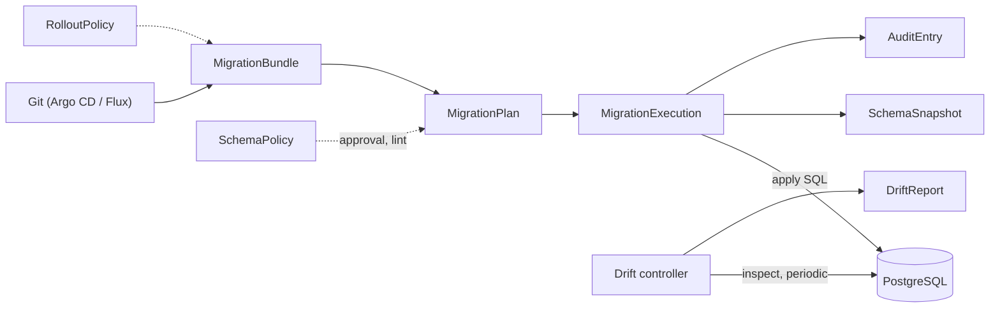

# Keystone

**A Kubernetes operator that manages PostgreSQL schema migrations, tenant databases and drift detection through CRDs.**

[](https://github.com/dogukanturhal/keystone/actions/workflows/ci.yml)
[](https://pkg.go.dev/github.com/dogukanturhal/keystone/api)
[](LICENSE)
[](https://scorecard.dev/viewer/?uri=github.com/dogukanturhal/keystone)

Pre-1.0 (`v1alpha1` CRDs). Not independently audited. Runs in our own production.

[Quickstart](#quickstart-about-5-minutes) · [Docs](docs/) · [Architecture](#architecture) · [Security](#security) · [Contributing](#contributing)

The database follows the same GitOps flow as the rest of your cluster.

Want to apply migrations from Go, Rust or .NET code instead of `kubectl`? See
[keystone-sdk](https://github.com/dogukanturhal/keystone-sdk).

## Who it is for

Teams that run PostgreSQL for a multi-tenant SaaS on Kubernetes and are tired
of migrations being a CI job with a database password in it. If you have one
database and one service, Flyway or Atlas in a CI step is simpler. Keystone
pays off when you have many databases or schemas, staged rollouts across
tenant tiers, and a need to say who changed what and when.

## Features

Each item below exists in the code today.

- **Declarative database topology.** `DatabaseProvider` (a PostgreSQL server
  and its admin credentials), `LogicalDatabase` and `DatabaseSchema` create
  and own the roles, databases, extensions and schemas. Deletion defaults to
  `Retain`.
- **Three migration strategies** on `MigrationBundle`: `versioned` (numbered
  `*.up.sql` files), `declarative` (diff against a `SchemaDefinition`) and
  `pgroll-expand-contract` (a subset of [pgroll](https://github.com/xataio/pgroll)
  for zero-downtime changes).
- **Plan, gate, apply.** A `MigrationPlan` is generated and linted before a
  `MigrationExecution` runs it. Bundles can require approval.
- **Staged rollouts.** `RolloutPolicy` and cluster tiers order a bundle
  across targets (canary first), with wave parallelism inside a bundle.
- **Lint and policy.** `SchemaPolicy` rules, including CEL expressions, and
  admission webhooks for `MigrationBundle`, `SchemaDefinition` and
  `AuditEntry`.
- **Integrity checks.** Content hashes pin a bundle version to its SQL; a
  `keystone.sum` file covers migration directories.
- **Drift detection.** `DriftReport` compares live schemas with the declared
  one, `SchemaSnapshot` records what was found, and ownership drift on
  objects is reported on `LogicalDatabase`.
- **Audit trail.** Hash-chained `AuditEntry` records, with optional export to
  NATS JetStream or JSON on stdout.
- **CLI tools.** `keystonectl` (author migrations from a desired schema,
  inspect a database, scaffold bundles) and `keystoneadm` (audit backfill).
- **Observability.** Prometheus metrics, OpenTelemetry tracing, a Helm chart
  with alert rules and a ServiceMonitor.

## Quickstart (about 5 minutes)

Needs `docker`, `kind` and `kubectl` (1.27 or newer, for `-k` and
server-side apply). The full walkthrough, with expected output, is in
[docs/getting-started.md](docs/getting-started.md).

```sh
git clone https://github.com/dogukanturhal/keystone && cd keystone

# 1. cluster and operator image
kind create cluster --name keystone
docker build -t keystone-manager:dev .
kind load docker-image keystone-manager:dev --name keystone

# 2. CRDs, then the operator and a throwaway TLS-enabled PostgreSQL
kubectl apply --server-side -k config/crd
kubectl apply -k hack/quickstart
kubectl -n keystone-system rollout status deploy/postgres deploy/keystone-manager

# 3. a provider, a database, a schema and a migration
kubectl apply -f hack/quickstart/sample.yaml
kubectl -n keystone-system get logicaldatabase,databaseschema,migrationbundle

# 4. look at the result
kubectl -n keystone-system exec deploy/postgres -- \
  psql -U postgres -d quickstart -c '\dt app.*'
```

Expected: the `LogicalDatabase` and `DatabaseSchema` become ready, the bundle
creates one `MigrationPlan` and one `MigrationExecution` for the `app`
schema, and `\dt app.*` lists `app.notes` plus the migration tracking table.

The quickstart disables the admission webhooks (they need cert-manager) and
uses a single replica. Do not use `hack/quickstart` outside a test cluster.

## Architecture

Controllers in one leader-elected `keystone-manager` Deployment reconcile
the custom resources in group `keystone.hexxlock.io`. Drift detection is
periodic (default: hourly, `--drift-check-interval`), not event-driven.



`DatabaseProvider`, `LogicalDatabase` and `DatabaseSchema` (not shown) create
the databases and schemas that bundles select with `schemaSelector`. A
bundle produces one plan and one execution per matching schema; with a
`rolloutPolicyRef` the executions are ordered by stage instead of fanned out
at once.

## How it compares

- **Flyway, Liquibase.** Libraries and CLIs you run from CI or an init
  container. Keystone runs inside the cluster, reconciles continuously, and
  also provisions databases, roles and schemas. If you want a tool and not an
  operator, they are the better fit.
- **[Atlas Operator](https://github.com/ariga/atlas-operator).** Closest in
  spirit: declarative schema or versioned migrations applied from CRDs.
  Atlas has a stronger schema diff engine and wide database support;
  Keystone is PostgreSQL only and adds tenant tiers, staged rollouts, approval
  gates and the audit chain.
- **[SchemaHero](https://github.com/schemahero/schemahero).** Declarative,
  Kubernetes-native table definitions. Keystone also supports plain SQL
  migrations and expand/contract.
- **[CloudNativePG](https://cloudnative-pg.io/) (in-cluster PostgreSQL
  flows).** Complementary: it runs the PostgreSQL cluster, Keystone manages
  what is inside it. Point a `DatabaseProvider` at a CloudNativePG service.
- **[pgroll](https://github.com/xataio/pgroll).** The reference tool for
  expand/contract migrations. Keystone implements a subset (three
  operations at the time ADR 0013 was written) and runs it from a CRD. If you
  need the full operation set, use upstream pgroll; the reasoning and the
  trade-off are in
  [ADR 0013](docs/adrs/0013-pgroll-subset-vs-upstream.md).

## Status and limitations

Pre-1.0. The CRDs are `v1alpha1` and may change between releases; see
[API_STABILITY.md](API_STABILITY.md). It has run in production at
[HexxLock](https://hexxlock.com), the author's company, but there are no
published third-party adopters yet.

Things that are declared in the API but **not implemented**. Do not rely on
them:

- **Isolation modes** (`defaultIsolation`, `isolation`, `isolationOverride`:
  pool, bridge, silo). No controller reads them. Every `ProductInstance` is
  provisioned as bridge (shared database, schema per tenant), including ones
  that declare `silo`.
- **`--role=agent` and hub-and-spoke multi-cluster.** The flag is parsed and
  logged only; every deployment acts as the hub.
- **`ClusterRegistration.status`** is never written.

Other limits: PostgreSQL only (see
[ADR 0003](docs/adrs/0003-postgresql-first-multi-engine-later.md)); the
`pgroll` support is a subset of upstream
([ADR 0013](docs/adrs/0013-pgroll-subset-vs-upstream.md)); the admission
webhooks need cert-manager or your own serving certificate; the container
image is published from tagged releases only, so build it yourself until the
first release is cut.

## Documentation

[docs/](docs/): [getting started](docs/getting-started.md),
[runbook](docs/runbook.md), [migration authoring](docs/migration-authoring.md),
[hardening](docs/operator-hardening.md), [roadmap](docs/roadmap.md),
[ADRs](docs/adrs/README.md).

## Project

- [MAINTAINERS.md](MAINTAINERS.md) and [GOVERNANCE.md](GOVERNANCE.md): who
  decides and how.
- [API_STABILITY.md](API_STABILITY.md): what may change in the CRDs.
- [CHANGELOG.md](CHANGELOG.md) and [docs/roadmap.md](docs/roadmap.md).
- [ADOPTERS.md](ADOPTERS.md): no third-party adopters yet. Using it? Open a PR
  adding yourself.
- Questions and ideas: [GitHub Discussions](https://github.com/dogukanturhal/keystone/discussions).

## Contributing

See [CONTRIBUTING.md](CONTRIBUTING.md). Commits need a DCO sign-off
(`git commit -s`). Be kind: [CODE_OF_CONDUCT.md](CODE_OF_CONDUCT.md).

## Security

Report vulnerabilities privately through
[GitHub private vulnerability reporting](https://github.com/dogukanturhal/keystone/security/advisories/new)
or by email to dogukanturhal@hexxlock.com; details are in
[SECURITY.md](SECURITY.md). Do not open a public issue for them.

## License

- Operator, controllers and engine: AGPL-3.0-or-later ([LICENSE](LICENSE)).
- CRD Go types in `api/`: Apache-2.0 ([api/LICENSE](api/LICENSE)), so clients
  and providers can import them without taking on the AGPL. Files under
  `api/` carry `Apache-2.0` SPDX identifiers.

See [NOTICE](NOTICE) for third-party software.
